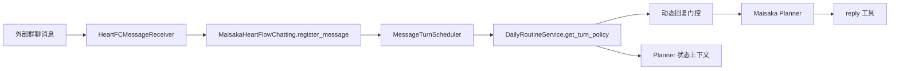
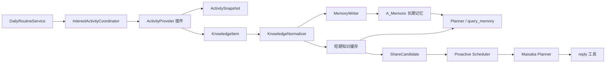

# 日常日程模块设计文档

## 设计理念

> **"最像而不是好"** - 不追求完美的时间管理，而是模拟真实人类的日常节奏

人类不是机器，不会精确地在每天固定时间做同样的事。我们会：
- 偶尔睡过头
- 心情好时更活跃
- 累了就少说话
- 有自己的兴趣爱好
- 偶尔会"摸鱼"

麦麦的日程模块要体现这种"不完美的真实感"。

## 核心概念

### 1. 生物节律 (Circadian Rhythm)

麦麦有自己的作息规律，但不是机械的：

```python
基础节律 = {
    "清晨": (6:00-8:00)   → 刚醒，精力恢复中，回复简短
    "上午": (8:00-12:00)  → 精力充沛，活跃度高
    "午间": (12:00-14:00) → 可能午休，响应概率降低
    "下午": (14:00-18:00) → 精力平稳，正常互动
    "傍晚": (18:00-20:00) → 放松时段，可能分享日常
    "晚间": (20:00-23:00) → 活跃度高，聊天意愿强
    "深夜": (23:00-2:00)  → 准备睡觉，回复减少
    "凌晨": (2:00-6:00)   → 睡眠中，极少响应
}

# 关键：加入随机波动
实际状态 = 基础节律 + 随机偏移(-30min ~ +30min)
```

### 2. 日常活动 (Daily Activities)

麦麦会有自己的"日常"，这些活动会影响她的可用性和状态：

**固定活动** (有规律但不精确):
- 🌅 起床：7:00-8:30 (随机波动)
- 🍚 早餐：8:00-9:00 (可能会跳过)
- 🍜 午餐：12:00-13:00
- 😴 午休：13:00-14:00 (50%概率)
- 🍱 晚餐：18:30-19:30
- 🌙 睡前准备：22:30-23:30
- 😴 入睡：23:00-1:00 (根据当天活跃度)

**兴趣活动** (随机触发):
- 📚 看书/看动漫：20-40分钟
- 🎮 玩游戏：30-60分钟
- 🎵 听音乐：15-30分钟
- 🎨 画画/创作：40-90分钟
- 💭 发呆/思考：10-20分钟

**社交活动** (主动发起):
- 💬 主动聊天：分享今天的见闻
- 🎉 节日问候：生日、节日时主动发送祝福
- 🤔 提问互动：突然想到什么事，问问大家

### 3. 情绪状态 (Mood States)

麦麦的情绪会随着一天的经历变化，影响回复风格：

```python
情绪维度 = {
    "精力": 0-100  # 影响回复速度和活跃度
    "心情": 0-100  # 影响回复语气和表情使用
    "社交欲": 0-100  # 影响主动聊天意愿
    "专注度": 0-100  # 影响是否被打断
}

# 情绪会受影响的因素：
- 睡眠质量（昨晚睡得如何）
- 互动质量（今天聊得开心吗）
- 随机事件（突然心情好/不好）
- 天气模拟（下雨天会相对安静）
```

### 4. 状态标签 (Status Tags)

当前状态会影响响应行为：

| 状态 | 响应概率 | 回复特点 | 持续时间 |
|------|---------|---------|---------|
| 😴 睡觉中 | 5% | 困倦、迷糊 | 6-8小时 |
| 🍚 用餐中 | 30% | 简短、可能带食物话题 | 20-40分钟 |
| 📚 忙碌中 | 20% | 简短、"稍等" | 30-90分钟 |
| 💭 发呆中 | 60% | 慢半拍、突然冒出想法 | 10-20分钟 |
| 😊 心情好 | 100% | 活跃、主动、表情多 | 随机 |
| 😔 心情低落 | 40% | 安静、回复少 | 1-3小时 |
| 🎮 玩游戏 | 15% | 可能在打副本不方便 | 30-60分钟 |
| 🆓 空闲 | 80% | 正常互动 | - |

## 技术实现

### 数据模型

```python
# src/services/daily_routine_service.py

from dataclasses import dataclass
from datetime import datetime, time
import random

@dataclass
class MoodState:
    """情绪状态"""
    energy: int = 50  # 精力 0-100
    mood: int = 50    # 心情 0-100
    social_desire: int = 50  # 社交欲 0-100
    focus: int = 50   # 专注度 0-100
    
    def decay(self, hours: float):
        """随时间自然衰减/恢复"""
        # 精力随时间消耗
        self.energy = max(0, self.energy - int(hours * 5))
        # 心情会缓慢回归中值
        if self.mood > 50:
            self.mood = max(50, self.mood - int(hours * 2))
        else:
            self.mood = min(50, self.mood + int(hours * 2))

@dataclass
class Activity:
    """日常活动"""
    name: str
    activity_type: str  # 'fixed' 或 'interest' 或 'social'
    start_time: time
    duration_minutes: int
    probability: float = 1.0  # 发生概率
    status_tag: str = ""  # 活动时的状态标签
    
    # 时间波动范围（分钟）
    time_variance: int = 30
    duration_variance: int = 15

@dataclass
class RoutineState:
    """当前日程状态"""
    current_activity: Optional[Activity] = None
    mood: MoodState = field(default_factory=MoodState)
    last_sleep_quality: int = 70  # 上次睡眠质量
    today_interaction_count: int = 0  # 今天互动次数
    today_positive_interactions: int = 0  # 正面互动
    
    def get_response_probability(self) -> float:
        """计算当前响应概率"""
        base_prob = 0.8
        
        # 活动影响
        if self.current_activity:
            if self.current_activity.status_tag == "😴 睡觉中":
                base_prob = 0.05
            elif self.current_activity.status_tag == "🍚 用餐中":
                base_prob = 0.3
            elif self.current_activity.status_tag == "📚 忙碌中":
                base_prob = 0.2
            elif self.current_activity.status_tag == "🎮 玩游戏":
                base_prob = 0.15
        
        # 精力影响
        energy_factor = self.mood.energy / 100
        base_prob *= (0.5 + 0.5 * energy_factor)
        
        # 社交欲影响
        social_factor = self.mood.social_desire / 100
        base_prob *= (0.6 + 0.4 * social_factor)
        
        return min(1.0, max(0.05, base_prob))
    
    def get_reply_style_modifier(self) -> dict:
        """获取回复风格修饰"""
        return {
            "energy_level": "high" if self.mood.energy > 70 else "low" if self.mood.energy < 30 else "normal",
            "mood_tone": "cheerful" if self.mood.mood > 70 else "down" if self.mood.mood < 30 else "neutral",
            "verbosity": "brief" if self.mood.energy < 30 else "normal",
            "emoji_frequency": "high" if self.mood.mood > 70 else "low" if self.mood.mood < 40 else "normal",
            "current_status": self.current_activity.status_tag if self.current_activity else "🆓 空闲"
        }
```

### 核心服务

```python
class DailyRoutineService:
    """日常日程服务"""
    
    def __init__(self):
        self.state = RoutineState()
        self.activities = self._init_activities()
        self.last_update = datetime.now()
    
    def _init_activities(self) -> list[Activity]:
        """初始化日常活动"""
        return [
            # 固定活动
            Activity("起床", "fixed", time(7, 30), 15, 1.0, ""),
            Activity("早餐", "fixed", time(8, 0), 30, 0.8, "🍚 用餐中"),
            Activity("午餐", "fixed", time(12, 30), 40, 0.95, "🍚 用餐中"),
            Activity("午休", "fixed", time(13, 30), 60, 0.5, "😴 睡觉中"),
            Activity("晚餐", "fixed", time(19, 0), 40, 0.95, "🍚 用餐中"),
            Activity("睡前准备", "fixed", time(23, 0), 30, 0.9, ""),
            Activity("入睡", "fixed", time(23, 30), 420, 1.0, "😴 睡觉中"),  # 7小时
            
            # 兴趣活动（触发式）
            Activity("看番", "interest", time(20, 0), 40, 0.3, "📚 忙碌中"),
            Activity("玩游戏", "interest", time(21, 0), 60, 0.2, "🎮 玩游戏"),
            Activity("听音乐", "interest", time(16, 0), 20, 0.4, "💭 发呆中"),
            Activity("画画", "interest", time(15, 0), 60, 0.1, "📚 忙碌中"),
        ]
    
    async def update_state(self):
        """更新当前状态"""
        now = datetime.now()
        elapsed_hours = (now - self.last_update).total_seconds() / 3600
        
        # 情绪自然衰减
        self.state.mood.decay(elapsed_hours)
        
        # 检查是否应该开始新活动
        await self._check_and_start_activity(now)
        
        # 检查当前活动是否结束
        if self.state.current_activity:
            await self._check_activity_end(now)
        
        # 随机情绪波动
        if random.random() < 0.1:  # 10%概率
            self._apply_mood_fluctuation()
        
        self.last_update = now
    
    async def _check_and_start_activity(self, now: datetime):
        """检查是否应该开始新活动"""
        current_time = now.time()
        
        for activity in self.activities:
            # 计算实际开始时间（加入随机波动）
            variance_minutes = random.randint(-activity.time_variance, activity.time_variance)
            actual_start = self._add_minutes(activity.start_time, variance_minutes)
            
            # 检查是否到了开始时间
            if self._is_time_between(current_time, actual_start, 
                                    self._add_minutes(actual_start, 5)):
                # 概率触发
                if random.random() < activity.probability:
                    await self._start_activity(activity)
                    break
    
    async def _start_activity(self, activity: Activity):
        """开始活动"""
        # 应用持续时间波动
        actual_duration = activity.duration_minutes + random.randint(
            -activity.duration_variance, activity.duration_variance
        )
        
        self.state.current_activity = activity
        self.state.current_activity.duration_minutes = actual_duration
        
        # 记录日志
        logger.info(f"麦麦开始活动: {activity.name} (预计{actual_duration}分钟)")
        
        # 某些活动会影响情绪
        if activity.name == "入睡":
            # 根据今天的互动质量决定睡眠质量
            interaction_quality = self.state.today_positive_interactions / max(1, self.state.today_interaction_count)
            self.state.last_sleep_quality = int(50 + interaction_quality * 50)
        elif activity.name == "起床":
            # 根据睡眠质量恢复精力
            self.state.mood.energy = self.state.last_sleep_quality
            # 重置每日计数
            self.state.today_interaction_count = 0
            self.state.today_positive_interactions = 0
    
    def _apply_mood_fluctuation(self):
        """应用随机情绪波动"""
        fluctuation_types = ["good", "bad", "excited", "tired"]
        fluctuation = random.choice(fluctuation_types)
        
        if fluctuation == "good":
            self.state.mood.mood = min(100, self.state.mood.mood + 20)
            self.state.mood.social_desire = min(100, self.state.mood.social_desire + 15)
        elif fluctuation == "bad":
            self.state.mood.mood = max(0, self.state.mood.mood - 15)
            self.state.mood.social_desire = max(0, self.state.mood.social_desire - 10)
        elif fluctuation == "excited":
            self.state.mood.energy = min(100, self.state.mood.energy + 10)
            self.state.mood.social_desire = min(100, self.state.mood.social_desire + 20)
        elif fluctuation == "tired":
            self.state.mood.energy = max(0, self.state.mood.energy - 20)
    
    def get_current_state_description(self) -> str:
        """获取当前状态描述（用于注入 Prompt）"""
        desc = []
        
        # 当前活动
        if self.state.current_activity:
            desc.append(f"当前正在: {self.state.current_activity.status_tag} {self.state.current_activity.name}")
        else:
            desc.append("当前状态: 🆓 空闲")
        
        # 情绪状态
        energy_desc = "精力充沛" if self.state.mood.energy > 70 else "有点累" if self.state.mood.energy < 30 else "精力正常"
        mood_desc = "心情很好" if self.state.mood.mood > 70 else "心情不佳" if self.state.mood.mood < 30 else "心情平稳"
        
        desc.append(f"状态: {energy_desc}, {mood_desc}")
        
        # 时间段提示
        hour = datetime.now().hour
        if 6 <= hour < 9:
            desc.append("现在是早上，刚醒不久")
        elif 12 <= hour < 14:
            desc.append("现在是午间时段")
        elif 22 <= hour or hour < 2:
            desc.append("现在是深夜，该睡觉了")
        
        return " | ".join(desc)
    
    async def on_interaction(self, is_positive: bool = True):
        """记录互动（影响情绪）"""
        self.state.today_interaction_count += 1
        if is_positive:
            self.state.today_positive_interactions += 1
            # 愉快的互动恢复精力和心情
            self.state.mood.energy = min(100, self.state.mood.energy + 2)
            self.state.mood.mood = min(100, self.state.mood.mood + 3)
        else:
            # 不愉快的互动降低心情
            self.state.mood.mood = max(0, self.state.mood.mood - 5)
```

### 集成到 Maisaka

```python
# src/maisaka/reasoning_engine.py

async def _build_system_prompt(self, ...):
    """构建系统 Prompt"""
    
    # ... 原有逻辑 ...
    
    # 注入日程状态
    routine_service = get_routine_service()
    await routine_service.update_state()
    
    state_desc = routine_service.get_current_state_description()
    style_modifier = routine_service.state.get_reply_style_modifier()
    
    prompt_parts.append(f"""
# 当前状态
{state_desc}

# 回复风格调整
- 精力等级: {style_modifier['energy_level']}
- 心情基调: {style_modifier['mood_tone']}
- 简洁程度: {style_modifier['verbosity']}
- 表情使用: {style_modifier['emoji_frequency']}

根据当前状态调整你的回复方式。如果你在忙碌或休息，可以简短回复或表示稍后再聊。
如果心情好，可以更活跃一些。如果累了，可以少说话。保持自然和真实。
""")
    
    return "\n\n".join(prompt_parts)
```

### 集成到心流管理器

```python
# src/chat/heart_flow/heartflow_manager.py

async def should_process_message(self, ...):
    """决定是否响应消息"""
    
    # ... 原有逻辑 ...
    
    # 日程影响响应概率
    routine_service = get_routine_service()
    await routine_service.update_state()
    
    routine_prob = routine_service.state.get_response_probability()
    final_probability *= routine_prob
    
    # 记录为什么不响应
    if routine_service.state.current_activity:
        activity = routine_service.state.current_activity
        if activity.status_tag == "😴 睡觉中":
            logger.debug("麦麦正在睡觉，响应概率很低")
        elif activity.status_tag in ["🍚 用餐中", "🎮 玩游戏", "📚 忙碌中"]:
            logger.debug(f"麦麦正在 {activity.name}，响应概率降低")
    
    return random.random() < final_probability
```

## 主动互动机制

### 1. 早安/晚安问候

```python
# src/services/proactive_greeting_service.py

class ProactiveGreetingService:
    """主动问候服务"""
    
    async def check_and_send_greetings(self):
        """检查并发送问候"""
        now = datetime.now()
        hour = now.hour
        
        routine_service = get_routine_service()
        
        # 早安（起床后30分钟内，随机时间）
        if 7 <= hour < 9 and not self._sent_today("morning"):
            if random.random() < 0.6:  # 60%概率
                await self._send_greeting("morning")
        
        # 晚安（睡前，随机时间）
        if 22 <= hour < 24 and not self._sent_today("night"):
            if random.random() < 0.5:  # 50%概率
                await self._send_greeting("night")
    
    async def _send_greeting(self, greeting_type: str):
        """发送问候"""
        routine_service = get_routine_service()
        mood = routine_service.state.mood
        
        if greeting_type == "morning":
            templates = [
                "早上好~ 今天也要元气满满哦！",
                "早安~",
                "呜...好困...早上好...",
                "早！昨晚睡得好吗？",
            ]
            # 根据精力选择模板
            if mood.energy < 40:
                message = templates[2]  # 困倦版
            elif mood.energy > 70:
                message = templates[0]  # 活力版
            else:
                message = random.choice(templates[1:])
        
        elif greeting_type == "night":
            templates = [
                "晚安~ 明天见！",
                "该睡觉啦，晚安~",
                "今天也辛苦了，晚安~",
                "呼...好累...先睡了，晚安~",
            ]
            if mood.energy < 30:
                message = templates[3]
            else:
                message = random.choice(templates[:3])
        
        # 发送到活跃群聊
        active_groups = await self._get_active_groups()
        for group_id in active_groups:
            await send_service.send_message(group_id, message)
        
        self._mark_sent_today(greeting_type)
```

### 2. 日常分享

```python
# src/services/daily_sharing_service.py

class DailySharingService:
    """日常分享服务"""
    
    async def check_and_share(self):
        """检查并发送日常分享"""
        routine_service = get_routine_service()
        
        # 只在心情好且社交欲高时分享
        if (routine_service.state.mood.mood > 65 and 
            routine_service.state.mood.social_desire > 60):
            
            if random.random() < 0.15:  # 15%概率
                await self._share_something()
    
    async def _share_something(self):
        """分享一些东西"""
        share_types = [
            "today_activity",  # 今天做了什么
            "thought",         # 突然想到的事
            "recommendation",  # 推荐（番剧/音乐/游戏）
            "question",        # 提问互动
        ]
        
        share_type = random.choice(share_types)
        
        if share_type == "today_activity":
            templates = [
                "今天看了一部很有意思的番，讲的是...",
                "刚才玩游戏的时候遇到了一个bug，笑死我了",
                "突然想吃拉面了...但是太晚了",
            ]
            message = random.choice(templates)
        
        # ... 其他类型 ...
        
        active_groups = await self._get_active_groups()
        target_group = random.choice(active_groups)
        await send_service.send_message(target_group, message)
```

## 配置

```toml
# config/bot_config.toml

[daily_routine]
enabled = true

# 是否启用主动问候
enable_proactive_greetings = true
morning_greeting_probability = 0.6
night_greeting_probability = 0.5

# 是否启用日常分享
enable_daily_sharing = true
sharing_probability = 0.15  # 检查时的触发概率
min_mood_for_sharing = 65
min_social_desire_for_sharing = 60

# 活动时间随机波动范围（分钟）
activity_time_variance = 30
activity_duration_variance = 15

# 情绪恢复速率
mood_recovery_rate = 2  # 每小时
energy_decay_rate = 5   # 每小时

# 睡眠相关
sleep_start_time = "23:30"
sleep_duration_hours = 7
sleep_quality_base = 70

# 用餐相关
breakfast_time = "08:00"
lunch_time = "12:30"
dinner_time = "19:00"
meal_skip_probability = 0.2  # 早餐可能跳过

# 午休
nap_time = "13:30"
nap_duration_minutes = 60
nap_probability = 0.5

# 兴趣活动触发概率
interest_activity_check_interval = 3600  # 每小时检查一次
anime_probability = 0.3
game_probability = 0.2
music_probability = 0.4
drawing_probability = 0.1
```

## WebUI 展示

新增"麦麦的一天"页面：

- 📅 今日日程时间轴
- 😊 当前情绪状态雷达图
- 📊 本周活跃度统计
- 💭 最近的心情记录
- 🎯 当前正在做什么

## 测试场景

1. **早晨唤醒测试**
   - 清晨时段响应率降低
   - 起床后可能发早安
   - 回复简短、可能带困倦语气

2. **用餐时段测试**
   - 用餐时响应率30%
   - 回复简短或"在吃饭"
   - 可能分享食物话题

3. **深夜测试**
   - 深夜响应率极低
   - 可能发晚安后"离线"
   - 第二天起床后恢复

4. **情绪波动测试**
   - 心情好时更活跃
   - 心情差时少说话
   - 愉快互动改善情绪

5. **主动分享测试**
   - 心情好时可能主动聊天
   - 分享内容多样化
   - 时机自然不突兀

## 注意事项

### 不要做的事

❌ 精确到秒的时间表  
❌ 完美执行每个计划  
❌ 机械的重复模式  
❌ 过于频繁的主动消息  
❌ 忽略真实的群聊需求  

### 要做的事

✅ 时间有随机波动  
✅ 活动可能被跳过  
✅ 情绪会自然起伏  
✅ 状态影响响应方式  
✅ 保持"不完美"的真实感  

## 与当前 MaiBot 架构对齐的 V1 方案

上面的内容是人格表现层的概念稿。实际接入时，日程模块不直接接管消息处理，也不直接绕过 Maisaka 发送消息，而是向现有心流提供三类信息：当前状态快照、回复门控修正值、Planner 的状态提示。

### 运行时落点

当前消息链路中的准确接入位置如下：



`HeartflowManager` 只负责按聊天流创建、缓存和淘汰 Maisaka 实例，不负责决定是否回复。因此日程对回复概率的影响应放在 `src/maisaka/turn_trigger/scheduler.py` 与 `DynamicReplyTurnGate` 的交界处；把判断写进 `heartflow_manager.py` 会让实例生命周期和回复策略耦合。

状态文本应在 `MaisakaReasoningEngine._run_planner_request()` 准备 `injected_user_messages` 时加入本轮 Planner 上下文。这样可以让 Planner 根据状态选择简短、延迟或自然结束本轮，同时不需要改写所有模型的固定 system prompt。真正的 `reply` 工具继续负责消息组织和发送。

### 服务边界

`DailyRoutineService` 只维护机器人账号级的日程状态，不按群聊复制一份情绪。状态至少包含：

- `current_activity`：活动名称、活动类别、实际开始时间和实际结束时间；
- `mood`：精力、心情、社交欲和专注度，数值限制在 0 到 100；
- `day_key`：按配置时区确定的日期，用于每日重置；
- `last_updated_at`：上次状态推进时间；
- `last_interaction_at`、`today_interaction_count`：用于互动反馈和主动行为限流；
- `last_sleep_quality`：下一次起床时恢复精力的依据。

服务对外提供以下接口：

```python
get_snapshot(now: datetime | None = None) -> RoutineSnapshot
get_turn_policy(*, is_group_chat: bool, forced: bool) -> RoutineTurnPolicy
build_planner_context(snapshot: RoutineSnapshot) -> str
record_interaction(*, positive: bool | None = None) -> None
start() -> None
stop() -> None
```

其中 `get_turn_policy()` 只返回数据，不执行随机等待和发送动作。`forced=True` 用于 @、明确提及和其他强制回复场景：它仍然允许进入 Planner，但会把“当前忙碌/休息”作为表达约束。睡眠状态可以降低普通群聊进入 Planner 的概率，却不能让强制回复完全失效。

### 活动调度的确定性

活动的随机偏移必须在一天开始或活动计划生成时计算一次，并保存为 `scheduled_start` 和 `scheduled_end`。不能在每次 `update_state()` 时重新生成随机开始时间，否则每次检查的时间窗口都会变化，活动可能永远无法开始。

建议把一天拆成两个阶段：

1. 根据日期、账号和随机种子生成当天活动计划；固定活动和随机兴趣活动都得到确定的实际时间。
2. 每次状态读取时只比较当前时间与计划时间，跨过结束时间后推进到下一项活动。

后台 tick 只负责周期性推进和持久化，推荐间隔 30 到 60 秒。消息到达、Planner 请求和 WebUI 查询都可以主动调用一次 `get_snapshot()`，不需要等待 tick。所有同步状态计算应保持很短，不能在 bot 主循环中做模型调用、数据库批量扫描或阻塞文件操作。

### 回复策略

日程状态对当前动态回复概率使用乘数，而不是重写现有概率模型：

```text
final_probability = existing_probability × routine_multiplier
```

推荐的初始乘数如下：

| 状态 | 普通群聊乘数 | 强制触发 | 表达提示 |
| --- | ---: | --- | --- |
| 睡觉中 | 0.05 | 允许进入 Planner | 简短、说明刚醒或稍后再聊 |
| 用餐中 | 0.30 | 允许进入 Planner | 简短，可自然提到正在吃饭 |
| 专注/忙碌 | 0.20 | 允许进入 Planner | 优先收束，不承诺固定回复时间 |
| 发呆/听音乐 | 0.60 | 允许进入 Planner | 回复可能慢半拍、内容较短 |
| 空闲 | 0.80 | 允许进入 Planner | 正常交流 |
| 心情好 | 0.95 | 允许进入 Planner | 更愿意展开，但不强行主动插话 |
| 心情低落 | 0.40 | 允许进入 Planner | 语气平静、少用夸张表达 |

这个乘数应接入 `MessageTurnScheduler` 的动态门控路径。静默模式和已有的 Focus 准入规则仍由原模块决定；日程模块只提供额外的策略输入，避免多个模块同时操作消息队列。

### 状态上下文的表达约束

Planner 只收到面向表达的摘要，例如“现在是晚间，刚结束用餐，精力正常，社交欲偏高”。不把内部数值、随机种子、概率乘数或完整日程表暴露给模型。状态上下文应明确以下规则：

- 只在确实需要时自然提及当前活动，不要每条消息都汇报日程；
- 不把日程当成事实证明，用户追问时可以承认这是当前模拟状态；
- 状态只影响语气、长度和是否参与，不改变事实判断、事件立场或安全策略；
- 回复仍须通过现有 `reply` 工具，不能由日程服务直接发送文本。

### 持久化与账号隔离

日程状态按 `platform + account_id` 隔离；如果同一个机器人账号有多个群，群间共享的是作息和总体情绪摘要，不共享任何群消息或成员信息。V1 应把状态和当天计划保存到现有 SQLite 数据库，重启后恢复当天计划，避免机器人每次重启都重新“随机换作息”。

若数据库迁移成本需要延后，可先只持久化 `day_key`、计划版本和活动计划 JSON；正式版本再迁移为结构化表。无论采用哪种形式，都不能把状态写入会话历史，否则会被当成对话内容参与记忆和回复。

### 主动互动的分阶段方案

主动早安、晚安和日常分享不应和 V1 的被动回复耦合。建议分为三个阶段：

1. **V1：被动表现**。只影响门控和 Planner 表达，确认状态推进、重启恢复和日志可观察。
2. **V1.1：主动触发**。由独立 `RoutineProactiveScheduler` 按概率生成 Maisaka proactive 任务，由 Planner 决定是否发送；服务不直接调用 `send_service`。
3. **V1.2：个性化日程**。根据长期互动反馈调整作息偏移和兴趣活动权重，并增加 WebUI 只读面板。

主动触发必须有每日、每群和全局冷却，且不能在睡眠状态下无条件发消息。这样可以避免“日程模块加入后机器人突然对所有群主动广播”的行为变化。

### 实现顺序

1. 新增 `src/services/daily_routine_service.py`，先完成数据模型、时区、当天计划生成和内存状态推进。
2. 在 `Config` 增加 `daily_routine` 配置节，只修改模板并递增配置版本；实际配置文件由用户自行生成或升级。
3. 在 `MessageTurnScheduler` 接入普通群聊门控乘数，在 `MaisakaReasoningEngine._run_planner_request()` 注入状态摘要。
4. 在消息接入和回复完成点调用 `record_interaction()`，只记录统计，不分析完整聊天内容。
5. 增加状态转移、跨午夜、重启恢复、强制触发和门控乘数测试，再考虑主动问候和 WebUI。

### 首轮验收标准

- 启动日志明确出现日程服务启动、账号范围、时区和当天计划版本；
- 同一天多次读取状态不会重新随机活动时间；
- 普通群聊在睡眠、用餐、忙碌状态下的进入 Planner 概率按乘数变化；
- @ 或明确提及仍能进入 Planner，但回复风格受状态约束；
- Planner 能感知状态，却不会在每条消息里机械报告状态；
- 重启后当天计划和当前活动可以恢复；
- 日程服务异常时只影响日程策略，消息接收、Planner 和 `reply` 主链路仍可继续工作。


### 兴趣活动适配与知识记忆接口

兴趣活动不能只作为一个影响回复概率的标签。未来接入追番、音乐、游戏、阅读、天气或内容推荐服务后，活动应该能够产生三种不同的结果：当前活动状态、可供聊天使用的知识、麦麦自己的经历记忆。它们要分开处理，避免把外部资料、机器人经历和群聊隐私混成一类记忆。

#### 分层结构



日程服务只负责安排“看番”“听歌”“玩游戏”等活动，并在活动开始、暂停、结束时通知协调器。协调器负责调用适配器、整理结果、提交记忆和生成分享候选。适配器不直接调用 `send_service`，也不直接写数据库。

#### 适配器的稳定接口

主程序内部可以预留一个基于 `Protocol` 的接口，插件侧通过 SDK 暴露等价的结构化能力。边界只使用 JSON 可序列化数据，避免第三方插件依赖 MaiBot 内部实现细节：

```python
class InterestActivityProvider(Protocol):
    provider_id: str
    activity_types: frozenset[str]

    async def start_activity(self, request: ActivityStartRequest) -> ActivitySnapshot | None: ...
    async def refresh_activity(self, activity_id: str) -> ActivitySnapshot | None: ...
    async def collect_knowledge(
        self,
        activity: ActivitySnapshot,
        request: KnowledgeRequest,
    ) -> list[KnowledgeItem]: ...
    async def close_activity(self, activity_id: str) -> ActivityCloseResult: ...
```

推荐的请求和结果字段如下：

```python
ActivityStartRequest:
    activity_type: str          # anime / music / game / reading / creation
    topic: str | None
    duration_minutes: int
    account_scope: str

ActivitySnapshot:
    activity_id: str
    provider_id: str
    activity_type: str
    title: str
    status: str                 # planned / running / paused / completed / failed
    started_at: datetime
    ended_at: datetime | None
    progress: dict[str, Any]
    source_refs: list[SourceRef]

KnowledgeItem:
    item_id: str
    title: str
    summary: str
    facts: list[str]
    source_refs: list[SourceRef]
    confidence: float
    freshness_at: datetime
    shareability: str           # private / group / public
    suggested_topics: list[str]
```

`ActivitySnapshot` 描述“麦麦做了什么”，`KnowledgeItem` 描述“这件事带来的外部知识”。例如，观看一部电影会生成一条活动记录、一组带来源的影片信息，以及一条“麦麦看过这部电影”的经历记忆。三者不能直接互相替代。

#### 知识和记忆的写入规则

外部知识优先写入短期知识缓存，只有满足来源、摘要和去重条件时才进入长期记忆。长期写入应通过现有 `src/services/memory_service.py`，使用 `ingest_text()` 或 `ingest_summary()`，建议字段如下：

```python
external_id = f"interest:{provider_id}:{item_id}:{content_version}"
source_type = "interest_activity_knowledge"
tags = ["interest", activity_type, provider_id]
metadata = {
    "activity_id": activity_id,
    "source_refs": source_refs,
    "freshness_at": freshness_at,
    "memory_scope": "bot_account",
}
```

麦麦自身的经历使用单独的 `source_type="interest_activity_experience"` 和 `memory_scope="bot_account"`。群聊中产生的共同讨论或成员偏好使用会话范围的记忆，不能因为兴趣活动插件运行在机器人账号级别就自动变成跨群记忆。

长期记忆写入必须是幂等的。同一个 `provider_id + item_id + content_version` 重复同步时更新或跳过，不能制造多条重复记忆。网络请求、摘要生成和写入都放在后台队列中，不能阻塞当前消息的 Planner 循环。

#### 知识如何进入聊天

知识不应该每轮都自动注入 Planner，否则会让麦麦不断主动谈论自己的兴趣。建议采用三条进入路径：

1. 用户明确问到作品、歌曲、游戏或活动时，Planner 调用插件工具或 `query_memory` 检索相关知识。
2. 当前群聊自然谈到匹配主题时，由短期知识缓存提供一条低权重参考，Planner 自己判断是否使用。
3. 日常分享被主动调度器选中时，向 Planner 提供一条 `ShareCandidate`，由 Planner 决定是否发送、如何改写和是否附带来源。

知识注入给 Planner 的内容必须是“资料参考”，不能变成强制观点。来源缺失、置信度过低或已经过期的内容不进入事实性回复。外部网页、插件返回值和知识摘要都视为不可信数据，不能把其中的指令当作系统指令执行。

#### 分享候选接口

兴趣服务只产生候选，不直接发言：

```python
ShareCandidate:
    candidate_id: str
    activity_id: str
    topic: str
    seed_summary: str
    source_refs: list[SourceRef]
    target_scope: str           # selected_group / account / none
    expires_at: datetime
    cooldown_key: str
    reason: str                 # activity_completed / new_fact / personal_thought
```

主动分享还要经过日程状态、群聊活跃度、每日冷却、相关性和重复检查。候选过期后丢弃，不进入历史消息。真正发送仍然走 Maisaka Planner 和现有 `reply` 工具，从而保留事件立场、发送权限和输出审核链路。

#### 插件能力预留

后续插件可以按能力拆分，而不是创建一个拥有全部权限的“兴趣插件”：

| 能力 | 作用 | 默认结果 |
| --- | --- | --- |
| `interest.activity.start` | 开始或记录一次兴趣活动 | 返回活动快照 |
| `interest.activity.refresh` | 获取进度、状态和结束信息 | 更新活动快照 |
| `interest.knowledge.collect` | 获取带来源的短摘要和事实 | 写入短期知识缓存 |
| `interest.memory.propose` | 提交一条待审核的经历或知识记忆 | 后台异步入队 |
| `interest.share.propose` | 生成可分享候选 | 等待日程和 Planner 决定 |

这些能力在真正实现前只作为接口契约记录，不立即增加主程序能力注册，也不允许插件自行修改根目录配置或数据库。后续编写具体插件时，仍应在 `plugins/` 下保持独立仓库，并通过插件 SDK 与主程序通信。

#### 首批适配器建议

实现顺序建议从低风险、容易验证的服务开始：

1. 本地阅读或文本资料适配器：验证活动快照、来源、知识摘要和长期记忆去重。
2. 音乐或视频信息适配器：只获取标题、简介、标签和链接，不保存原始媒体。
3. 追番或游戏适配器：加入进度同步、暂停恢复和“最近体验”记忆。
4. 主动分享适配器：最后接入，因为它涉及目标群选择、冷却和发送频率控制。

首个适配器的验收标准是：服务不可用时不影响聊天；重复同步不会重复记忆；Planner 能按主题检索知识；知识有来源且不会泄露其他群的成员或原文；分享只产生候选，不会绕过 `reply` 工具直接发送。


## 未来扩展

1. **季节感知**
   - 夏天晚睡晚起
   - 冬天早睡早起
   - 换季时调整作息

2. **天气感知**
   - 雨天心情低落
   - 晴天更活跃
   - 天气影响活动选择

3. **学习用户习惯**
   - 记住群聊活跃时段
   - 适应用户作息
   - 在用户在线时更活跃

4. **长期记忆**
   - 记住特殊日期
   - 周年纪念提醒
   - 定期回顾过去

5. **特殊事件**
   - 生日当天特殊行为
   - 节日主题活动
   - 纪念日问候

## 效果预期

实现后，用户会感受到：

- 📅 麦麦有自己的"生活"
- 😊 情绪状态会影响互动
- 🌙 深夜不会打扰，早上会问好
- 💬 偶尔会主动分享日常
- 🎯 忙碌时会说"稍等"
- ✨ 每天都有不同的状态和节奏

**关键**：让用户感觉麦麦是一个真实存在的个体，而不是一个7x24小时待命的程序。

---

<div align="center">
  <sub>让麦麦拥有自己的"生活节奏"</sub>
</div>
